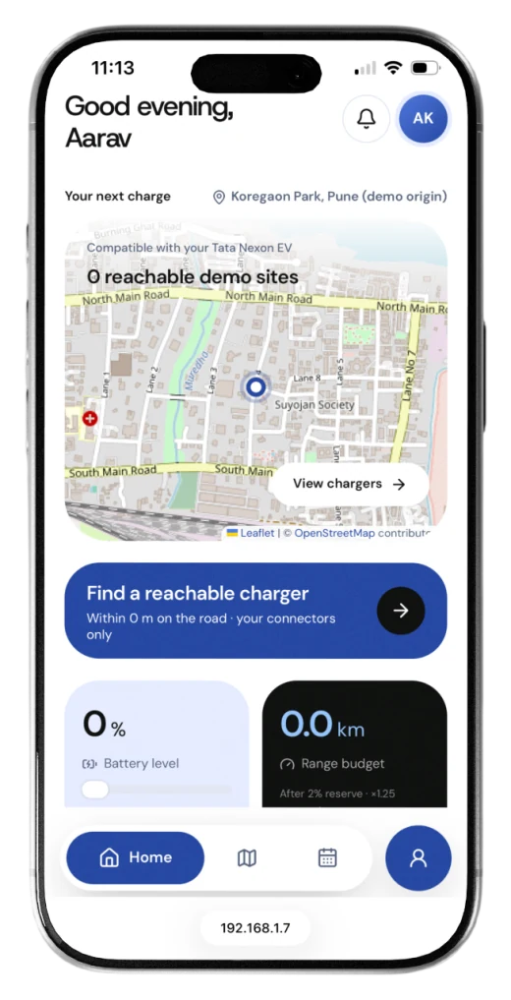
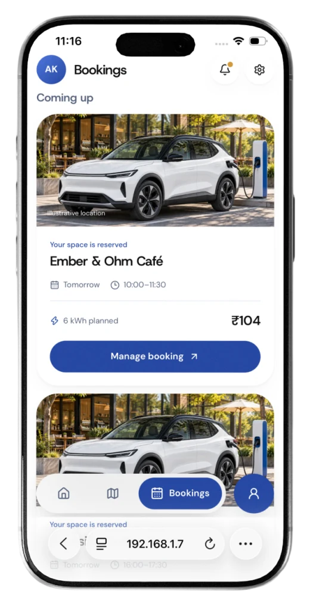
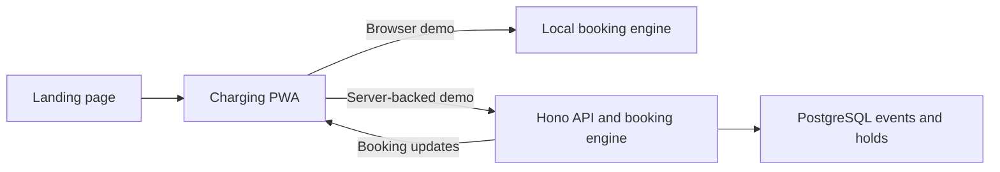

# Ampere

**Find a charger your EV can reach, use, and book.**

<p align="center">
  
  
  
  
  
</p>

<p align="center">
  
  
  
</p>

<p align="center"><em>Mobile demo mockups · Home, Profile, and Bookings with sample data</em></p>

## Overview

A map pin alone cannot tell an EV driver whether a charger is within range, fits their car, or can be reserved. Ampere is a Pune-based prototype that filters chargers by an estimated road budget and plug compatibility, then lets drivers book a demo bay at a café, office, or residential site.

Community listings and accounts are synthetic. Checkout, refunds, charging measurements, receipts, and payouts use simulated values. The backend also ships a snapshot of real public chargers from Open Charge Map with OSRM road distances measured from the console's demo origin. Those directory entries appear in the jury console and search API. The driver's Stations screen shows bookable demo sites.

## Portals and features

| Role | What to try |
| --- | --- |
| **Driver** · Aarav or Kabir | Edit a vehicle profile and battery level, find a charger, reserve a bay, track bookings, and see visit summaries and receipts. |
| **Host** · Rohan or Meera | Submit and manage listings, configure schedules and blocked times, respond to booking requests, run demo charging sessions, and review illustrative earnings. |
| **Operations** · Ops admin | Review listing checks, request changes, activate or suspend listings, and inspect the audit trail. |
| **Jury** · Jury panel | Run `TICKET` to filter chargers and request a demo booking, then use the printed `READY` command to confirm it through the same booking services. |

### Driver workflows

- **Discover** — Search eligible sites in map or list view. The driver starts from a fixed MIT-WPU location in Pune and provides their battery level. Ampere filters by estimated road range, connector, listing approval, and charger status.
- **Reserve and charge** — Compare access and price, select a bay and time, confirm cable arrangements, then request host approval. Complete demo checkout, use an arrival code, and follow the session through charging and completion. Recent alerts distinguish booking and payment updates.
- **Bookings and receipts** — Manage upcoming reservations and open completed visit summaries. The seeded receipt `AMP-DEMO02` includes an illustrative ₹132 revenue breakdown.

### Tools in Profile

- **Trip planner and saved stations** — Compare sample highway routes using departure battery, view suggested charging stops and pins on a map, save a plan on the device, and bookmark stations.
- **Savings and driving journal** — Estimate EV versus fuel costs using editable assumptions and log drives.
- **Society hub and solar badges** — Browse or save apartment-charging learnings and see illustrative solar information on supported listings.
- **Connections and fleet planning** — Try simulated vehicle connections, inspect sample fleet vehicles, and save charging drafts. These tools use demo data and browser-local storage.

## Architecture

| Layer | Stack and responsibility |
| --- | --- |
| Landing page | Vite, GSAP, and Lenis serve the landing page at `/` and link to the charging app at `/app/`. |
| Web app | React 19, TypeScript, React Router, and Tailwind CSS 4. The installable PWA uses Workbox, Leaflet, and OpenStreetMap tiles. |
| Browser demo | The booking engine runs in the browser. Local storage persists demo state, Web Locks coordinate writes, and BroadcastChannel shares updates between tabs. |
| Server-backed demo | Node.js and Hono run the same booking engine behind HTTP APIs. Signed tab sessions identify the actor, and server-sent events sync bookings across devices. |
| Persistence | PostgreSQL stores append-only booking events and rejects overlapping charger holds. Replaying those events restores bookings after a server restart. |



A booking request records an event and holds the slot. In server-backed mode, the API commits the event to PostgreSQL before replying and streams the update to eligible sessions. The server runs a single booking engine instance. The browser demo works without PostgreSQL or API credentials. Map tiles require network access.

## Folder overview

| Path | Contents |
| --- | --- |
| `src/` and `public/` | Landing page, animations, and static assets |
| `frontend/src/pages/` and `frontend/src/features/` | Portal screens and driver tools |
| `frontend/src/domain/` and `frontend/src/server/` | Booking, availability, discovery, and simulation logic shared with the backend |
| `backend/src/` and `backend/client/` | Hono API, realtime updates, persistence, and web client adapters |
| `backend/db/` and `backend/data/` | PostgreSQL migrations and the public charger snapshot |
| `assets/readme/` | README mockups |

## Run locally

Use Node.js **22.12+** and npm. The server-backed mode also requires PostgreSQL **15+**.

```bash
git clone --branch main https://github.com/Soham-commits/Ampere.git
cd Ampere
npm ci
npm ci --prefix frontend
```

### Browser demo

```bash
npm run dev
```

Open the [landing page](http://localhost:5173/) or [start as Aarav](http://localhost:5173/app/?demo=driver). This mode requires no `.env`. To try driver and host together, open a second tab at `/app/signin` and select Rohan.

### PostgreSQL-backed demo

Create a local database and build the server-backed web app.

```bash
createdb ampere
cd backend
npm ci
cp example.env .env
npm run build:web
```

Set the connection URI and a unique signing key in `backend/.env`. The URI below works for a local PostgreSQL instance that accepts your current user. Generate a key with `openssl rand -hex 32`.

```dotenv
DATABASE_URL=postgres://localhost:5432/ampere
TOKEN_SECRET=replace_with_a_generated_signing_key
PORT=8787
```

```bash
node --env-file=.env --import tsx src/main.ts
```

The first start migrates and seeds the database. Open the [server-backed app](http://localhost:8787/app/) or the [jury console](http://localhost:8787/app/jury). Phones on the same Wi-Fi can use the network URL printed at startup.

| Optional setting | When to use it |
| --- | --- |
| `CORS_ORIGIN`, `VITE_AMPERE_API_URL` | Configure a separate web origin and API URL. Export the API URL when running `npm run build:web`. |
| `OCM_API_KEY` | Refresh the bundled charger snapshot with `npm run import:chargers`. Export your key before running the importer. `IMPORT_RADIUS_KM` and `OSRM_URL` customize the import. |

In the jury console, try `TICKET|Tata Nexon EV|4|18.5362|73.8939|CCS2` as **Jury panel**. Follow the printed `READY` command to confirm the demo request.

For reset, hot reload, and database test commands, see the [backend guide](backend/README.md). Run `npm test --prefix frontend` from the root for app tests.

## Team

Team Stochastic · Harsh Gidwani, Soham Nigam, Samarth Bolkotgi, and Aryan More.

[Product solution document](Ampere_Solution_Document.md) · [Charging app guide](frontend/README.md) · [Backend guide](backend/README.md)
